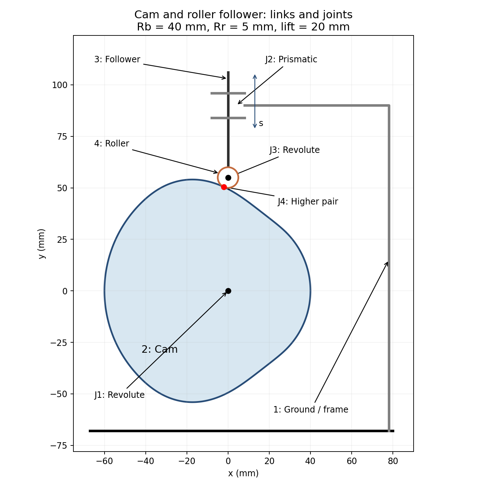

# Cam and Follower — Symbolic Analysis and Synthesis

**ผู้จัดทำ:** นายภูริณัฐ ไชยขาว (Phurinat Chaikaow) · Mechanical Engineering, Chulalongkorn University  
**เทคนิค:** Symbolic Mathematics · **ปรับปรุง:** 2026-10-19  
**สถานะ:** เตรียมโค้ดและตรวจคำนวณอิสระแล้ว ยังรอทดสอบใน MATLAB จริง

## รันโครงงาน

ใช้ **MATLAB พร้อม Symbolic Math Toolbox** ดาวน์โหลด repository เป็น ZIP แล้วแตกไฟล์ เปิด `RUN_ALL.m` และกด **Run** จะเห็นกลไกสองกรณีตามลำดับ และได้ไฟล์ `RETURN_TO_REVIEW_วันที่เวลา.zip` สำหรับตรวจผล ห้ามปิดหน้าต่างภาพระหว่างบันทึกวิดีโอ

หากตรวจแยกงาน ให้ตั้ง Current Folder เป็นโฟลเดอร์ repository แล้วใช้:

```matlab
addpath('simulation')
run_main       % งานหลัก: กลไกขนาดกำหนด
run_bonus      % โบนัส: สังเคราะห์กลไกตามโจทย์ใหม่
```

## 1. งานหลัก: Symbolic analysis

แคมหมุนตามเข็มนาฬิกา ขับตัวตามลูกกลิ้งให้เลื่อนในแนวดิ่งผ่านศูนย์แคม ระยะยก 20 mm รัศมีฐาน 40 mm รัศมีลูกกลิ้ง 5 mm ความเร็ว 60 rpm รอบหนึ่งแบ่งเป็นยก–ค้างบน–ลดลง–ค้างล่าง ช่วงละ 90°

โค้ดอินทิเกรตความเร่งไซน์และแก้ค่าคงที่ด้วย symbolic จากนั้นหาอนุพันธ์และสร้างผิวแคมด้วยแนวปกติของเส้นพิตช์ ภาพเคลื่อนไหวใช้พิกัดจากแบบจำลองเดียวกัน ไม่มีการเลื่อนลูกกลิ้งด้วยสมการคนละชุด

$$F(u)=u-\frac{\sin(2\pi u)}{2\pi},\quad s=hF(u),\quad v=\omega\frac{ds}{d\theta},\quad a=\omega^2\frac{d^2s}{d\theta^2}.$$

สูตร $s=hF(u)$ ใช้ช่วงยก ช่วงลดใช้ $s=h[1-F(u)]$ โดย $u$ เริ่มจาก 0 ใหม่ในแต่ละช่วง ความเร็วและความเร่งต่อเนื่องกับช่วงค้าง แต่ jerk มีการกระโดดแบบค่าจำกัด



| จุดต่อ | ชิ้นส่วน | ประเภท |
|---|---|---|
| J1 | 1 ฐาน – 2 แคม | Revolute |
| J2 | 1 ฐาน – 3 ก้านตัวตาม | Prismatic |
| J3 | 3 ก้านตัวตาม – 4 ลูกกลิ้ง | Revolute |
| J4 | 2 แคม – 4 ลูกกลิ้ง | Higher pair: contact |

**DOF:** แบบเต็มมี $n=4$, $j_1=3$, $j_2=1$ จึงได้ $M=3(n-1)-2j_1-j_2=2$ โดยหนึ่งตัวแปรเป็นการหมุนอิสระของลูกกลิ้ง ซึ่งไม่เปลี่ยนระยะยก เมื่อละตัวแปร passive นี้ แบบจำลองอินพุต–เอาต์พุตมี **DOF = 1** กำหนดมุมแคมแล้วหาระยะยกได้ ภาพเคลื่อนไหวไม่กำหนดการหมุนรอบตัวเองของลูกกลิ้ง และไม่ได้อ้างว่ากลิ้งไม่ไถล

ช่วงทำงานของศูนย์ลูกกลิ้งในงานหลัก: $x=0$, $45\le y\le65$ mm

## 2. โบนัส: Synthesis

**โจทย์ใหม่ที่กำหนด:** ต้องการระยะยก **30 mm** โดยคงรัศมีลูกกลิ้ง 5 mm และช่วงการเคลื่อนที่เดิม ออกแบบรัศมีฐานให้เล็กที่สุดตามข้อจำกัดมุมกด $|\phi|\le30^\circ$ แล้วตรวจรัศมีความโค้งนูนของเส้นพิตช์ไม่น้อยกว่า 7 mm เลือกขนาดเพิ่มทีละ 0.5 mm เป็นเงื่อนไขของกรณีศึกษา

$$R_b\ge B(u)=\frac{hF'(u)}{\beta\tan30^\circ}-R_r-hF(u).$$

โค้ดหาอนุพันธ์ $B'(u)$ แบบ symbolic ประเมินจุดวิกฤตและปลายช่วงเพื่อหารัศมีฐานขั้นต่ำจากมุมกด แล้วตรวจความโค้งและการแทรกสอด พร้อมแสดงกลไกที่ออกแบบได้ รายละเอียดสั้นใน [design.md](docs/design.md)

## โครงสร้างและผลตรวจ

จัดตาม [template ของอาจารย์](https://github.com/cratchat/mechanical-engineering-project-template): `simulation/` เก็บโค้ด, `media/` เก็บภาพ, `docs/` เก็บคำอธิบาย, `experiments/` เก็บการตรวจเชิงคำนวณ ส่วนฮาร์ดแวร์ เฟิร์มแวร์ และการทดลองกายภาพไม่อยู่ในขอบเขตงาน Symbolic นี้

โค้ดตรวจเงื่อนไขปลายช่วง ระยะยก มุมกด ความโค้ง ระยะ offset การแทรกสอดบนจุดตัวอย่าง และอนุพันธ์เทียบผลต่างกลาง ดู [สถานะตรวจสอบ](experiments/README.md)

**สมมติฐาน:** ชิ้นส่วนแข็งเกร็ง คงสัมผัส และความเร็วแคมคงที่ เป็นการจำลองเชิงจลนศาสตร์ ยังไม่ได้คำนวณแรงสปริง แรงสัมผัส หรือความเค้น จึงไม่ใช่การยืนยันว่าอุปกรณ์จริงไม่หลุดสัมผัส

## อ้างอิง

- [Carnegie Mellon University — Cams](https://www.cs.cmu.edu/~rapidproto/mechanisms/chpt6.html): กลไกแคม การกลับการเคลื่อนที่ และ passive roller DOF
- [METU — Basic Cam Motion Curves](https://ocw.metu.edu.tr/pluginfile.php/6886/mod_resource/content/1/ch8/8-3.htm): กฎการเคลื่อนที่ไซคลอยด์
- [METU — Cam Size Determination](https://ocw.metu.edu.tr/pluginfile.php/5791/mod_resource/content/8/ch8/8-4a.htm): มุมกดและขนาดแคม โดยจุดวิกฤตในโครงงานหาเองจากอนุพันธ์
