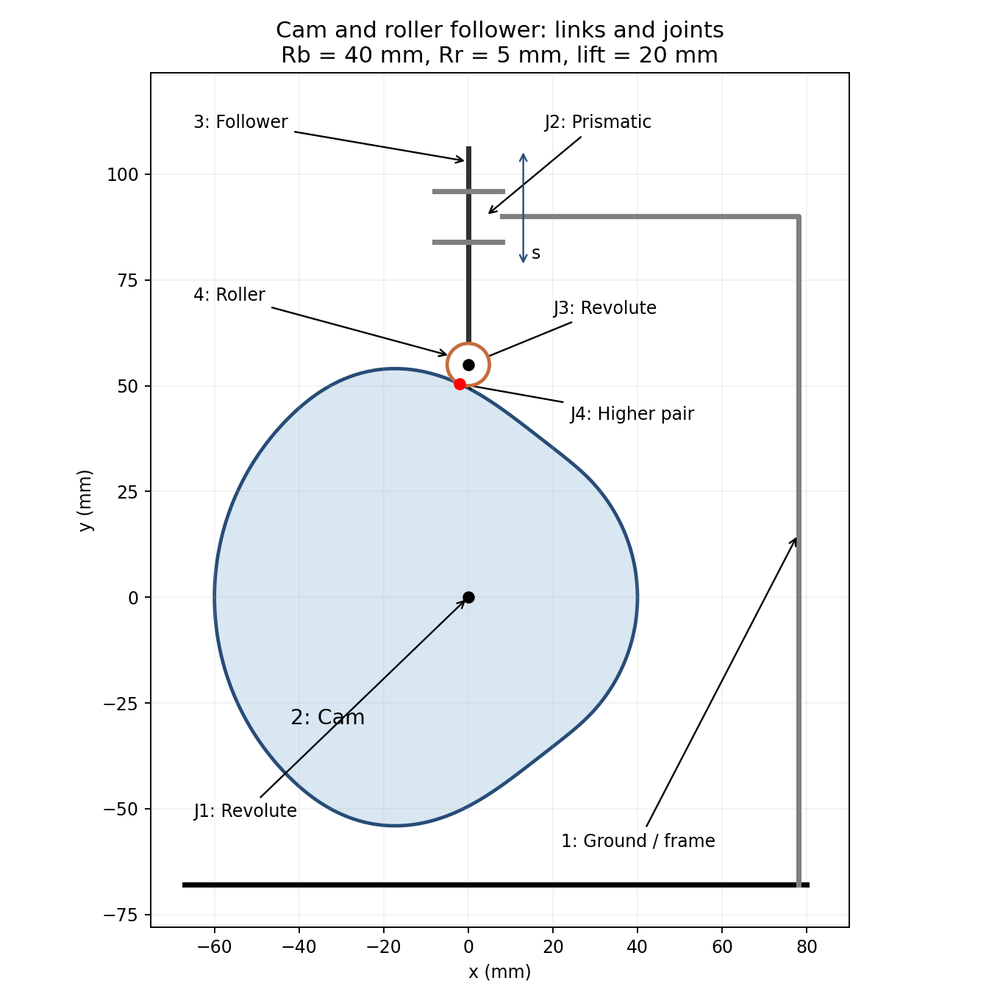
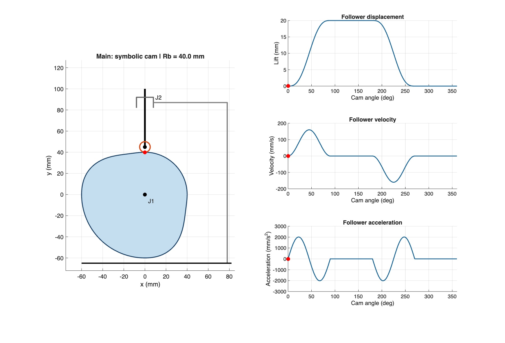
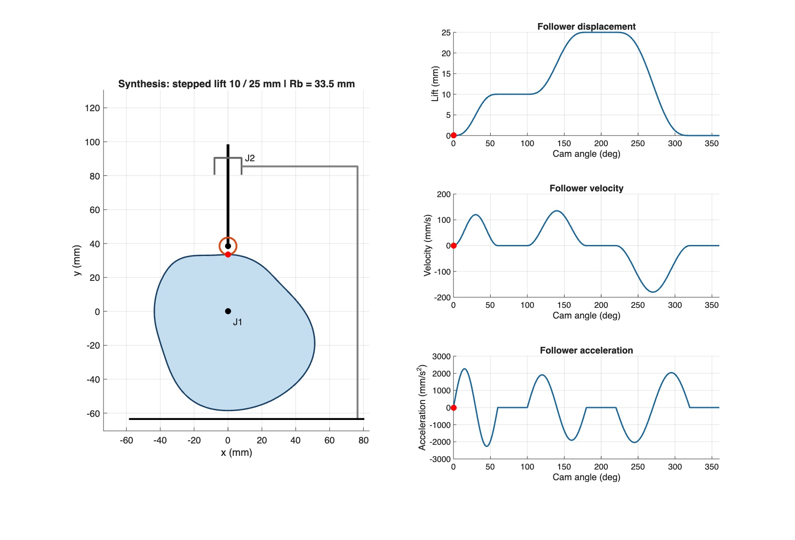

# Cam and Follower

นายภูริณัฐ ไชยขาว · Phurinat Chaikaow  
2103-322 Design of Mechanism · Symbolic Mathematics

วิเคราะห์แคมจานกับตัวตามลูกกลิ้งเลื่อนตรง และสังเคราะห์แคมยกสองระดับเป็นโบนัส

## ไฟล์ส่งงาน

| ไฟล์ | เนื้อหา |
|---|---|
| [Report.docx](Report.docx) | รายงาน 2 หน้า |
| [Report.pdf](Report.pdf) | รายงาน 2 หน้า สำหรับพิมพ์ |
| [Mechanism.mlx](Mechanism.mlx) | Symbolic analysis และคำสั่งรัน |
| [Mechanism.avi](Mechanism.avi) | ภาพเคลื่อนไหวพร้อมกราฟ s/v/a |
| [Render.jpg](Render.jpg) | ภาพกลไกและกราฟ |
| [simulation/](simulation/) | โค้ด MATLAB ประกอบ |
| [bonus/](bonus/) | วิดีโอและภาพ Synthesis |

## แบบจำลองกลไก



แคมหมุนตามเข็มนาฬิกาที่ 60 rpm ขับตัวตามในแนวดิ่ง กำหนดรัศมีฐาน 40 mm รัศมีลูกกลิ้ง 5 mm และระยะยก 20 mm รอบหนึ่งแบ่งเป็นยก–ค้างบน–ลด–ค้างล่าง ช่วงละ 90°

ลิงก์ 1 ฐาน, 2 แคม, 3 ก้านตัวตาม และ 4 ลูกกลิ้ง ข้อต่อ J1/J3 เป็น Revolute, J2 เป็น Prismatic และ J4 เป็น Higher pair

แบบเต็มมี $n=4$, $j_1=3$, $j_2=1$ จึงได้ $M=3(n-1)-2j_1-j_2=2$ โดยหนึ่งตัวแปรเป็นการหมุนอิสระของลูกกลิ้ง เมื่อละตัวแปรนี้ ความสัมพันธ์มุมแคม–ระยะยกมี DOF เท่ากับ 1 ช่วงทำงานของศูนย์ลูกกลิ้งคือ $x=0$, $45\le y\le65$ mm

## Symbolic analysis

อินทิเกรตความเร่งไซน์และแก้ค่าคงที่ด้วย Symbolic Math Toolbox ได้กฎ Cycloidal แล้วหาอนุพันธ์เพื่อคำนวณความเร็วและความเร่ง

```math
F(u)=u-\frac{\sin(2\pi u)}{2\pi},\qquad
v=\omega\frac{ds}{d\theta},\qquad
a=\omega^2\frac{d^2s}{d\theta^2}.
```

ช่วงยกใช้ $s=hF(u)$ ช่วงลดใช้ $s=h[1-F(u)]$ โดย $u$ เริ่มจาก 0 ใหม่ในแต่ละช่วง ผิวแคมได้จากการ offset เส้นทางศูนย์ลูกกลิ้งเข้าด้านในตามแนวปกติ



## Synthesis

กำหนดตัวตามยกจาก 0 ถึง 10 mm ที่ 0–60°, ค้างถึง 100°, ยกต่อถึง 25 mm ที่ 100–180°, ค้างถึง 220°, ลดลงถึง 0 mm ที่ 220–320° และค้างจนจบรอบ

หารัศมีฐานจากข้อจำกัดมุมกดไม่เกิน 30° และตรวจรัศมีความโค้งนูนของ pitch curve ไม่น้อยกว่า 7 mm ได้ขอบล่าง 33.385 mm เลือก **33.500 mm** มุมกดสูงสุด **29.941°** และรัศมีความโค้งนูนต่ำสุด **22.103 mm**



## การรัน

ดาวน์โหลดและแตก ZIP ทั้งโครงการ ใช้ MATLAB พร้อม Symbolic Math Toolbox เปิด `Mechanism.mlx` แล้วกด Run All หรือรัน [RUN_ALL.m](RUN_ALL.m) ผลใหม่บันทึกใน `results/main/` และ `results/bonus/`

โค้ดหลักอยู่ใน [cam_model.m](simulation/cam_model.m), [run_main.m](simulation/run_main.m) และ [run_bonus.m](simulation/run_bonus.m) ปุ่ม Play/Pause, Reset และ Playback speed ใช้ดูผลต่อได้ โดยไม่เปลี่ยน 60 rpm ที่ใช้คำนวณ

แบบจำลองใช้ชิ้นส่วนแข็งเกร็ง ความเร็วแคมคงที่ และคงสัมผัส หน่วย mm, s, rad ไม่วิเคราะห์แรง ความแข็งแรง หรือการหลุดสัมผัส
