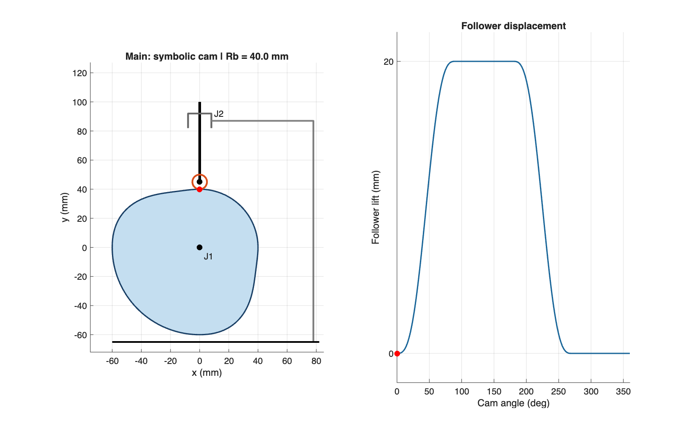
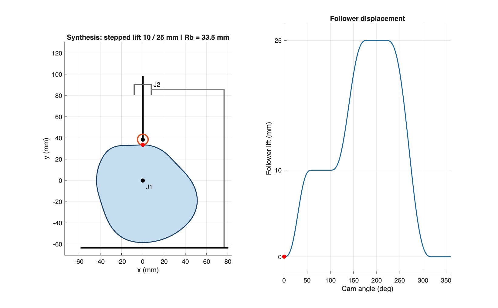

# Cam and Follower — Symbolic Analysis and Synthesis

โครงงานวิเคราะห์และสังเคราะห์กลไกแคม–ตัวตามด้วย Symbolic Mathematics จัดตาม [Mechanical Engineering Project Template](https://github.com/cratchat/mechanical-engineering-project-template)

## โค้ดหลักของโครงงาน

| ส่วนงาน | เปิดดูโค้ด | หน้าที่ |
|---|---|---|
| Symbolic model | [cam_model.m](simulation/cam_model.m) | สร้างสมการการเคลื่อนที่ด้วย Symbolic และคำนวณผิวแคม |
| งานหลัก | [run_main.m](simulation/run_main.m) | วิเคราะห์กลไกตามขนาดที่กำหนดและแสดงภาพเคลื่อนไหว |
| Synthesis โบนัส | [run_bonus.m](simulation/run_bonus.m) | สังเคราะห์แคมยกสองระดับและหารัศมีฐานจากข้อจำกัดมุมกด |
| รันทั้งสองงาน | [RUN_ALL.m](RUN_ALL.m) | เรียกงานหลักและ Synthesis ตามลำดับ |

[รูป links–joints และการวิเคราะห์ DOF](#symbolic-analysis) · [โค้ดสร้างภาพเคลื่อนไหว](simulation/render_cam.m) · [โค้ดตรวจสอบผล](simulation/validate_cam.m)

## Getting started

1. ดาวน์โหลดหรือ clone repository นี้ แล้วเปิดโฟลเดอร์ใน MATLAB พร้อม Symbolic Math Toolbox
2. เปิด `RUN_ALL.m` แล้วกด Run ตามวิธีรันด้านล่าง
3. อ่านคำอธิบายในแต่ละโฟลเดอร์; ส่วนที่ไม่ใช้กับงาน symbolic ระบุไว้ว่า Not applicable
4. ติดตามงานใน [GitHub Issues](https://github.com/Beam004MECU/Cam-Follower-Symbolic/issues) และอ่านการตัดสินใจออกแบบใน [docs/design.md](docs/design.md) กับผลตรวจใน [experiments/README.md](experiments/README.md)
5. ตรวจ [LICENSE](LICENSE) ก่อนนำงานไปใช้ต่อหรือเผยแพร่ซ้ำ

## Project overview

- **Project name:** Cam and Follower — Symbolic Analysis and Synthesis
- **Problem / purpose:** วิเคราะห์ระยะยก ความเร็ว ความเร่ง และผิวแคมด้วย symbolic พร้อมสังเคราะห์แคมยกสองระดับจากข้อจำกัดมุมกดและตรวจสอบเรขาคณิต
- **Team:** นายภูริณัฐ ไชยขาว (Phurinat Chaikaow) — ผู้จัดทำโครงงาน การวิเคราะห์ การจำลอง และเอกสาร · Mechanical Engineering, Chulalongkorn University
- **Status:** แก้โค้ดรอบตรวจละเอียดแล้ว; ผลตรวจอิสระผ่าน รอยืนยัน MATLAB รุ่นแก้ (validation revision 2)
- **Last updated:** 2026-10-23
- **Technique:** Symbolic Mathematics

**วิธีรัน:** MATLAB พร้อม Symbolic Math Toolbox → เปิด `RUN_ALL.m` แล้วกด Run บันทึก AVI งานละ 3 รอบอัตโนมัติ เมื่อจบแล้วกด **Play / Pause** เพื่อดูต่อเนื่อง หรือ **Reset** เพื่อกลับมุมเริ่มต้น ปรับ **Playback speed** ได้ตั้งแต่ 0.1× ถึง 2× (เริ่มที่ 0.25×) โดยไม่เปลี่ยนความเร็ว 60 rpm ที่ใช้คำนวณและบันทึก AVI

รุ่นแก้แสดงกราฟระยะยก ความเร็ว และความเร่ง พร้อมกลไกในหน้าต่างเดียวกัน ผลและสื่อจาก MATLAB ที่เก็บใน repository เป็นของรุ่นก่อนแก้ ให้รัน `RUN_ALL.m` ใหม่ แล้วใช้ ZIP ที่สร้างขึ้นยืนยันรุ่นนี้ รายละเอียดอยู่ใน [ผลตรวจ](experiments/README.md)

## Repository structure

| Path | Purpose |
|---|---|
| [hardware/mechanical/](hardware/mechanical/) | CAD แบบผลิตและประกอบ: Not applicable สำหรับงานนี้; แบบจำลองอยู่ใน simulation |
| [hardware/electronics/](hardware/electronics/) | วงจร PCB และสายไฟ: Not applicable |
| [hardware/bom.csv](hardware/bom.csv) | คงหัวตาราง BOM ตามเทมเพลต; ไม่มีรายการจัดซื้อฮาร์ดแวร์ |
| [software/firmware/](software/firmware/) | ไมโครคอนโทรลเลอร์: Not applicable |
| [software/application/](software/application/) | สภาพแวดล้อม MATLAB การติดตั้งและวิธีรัน |
| [machine-skills/](machine-skills/) | คำสั่งเครื่องจักร: Not applicable |
| [simulation/](simulation/) | โค้ด symbolic แบบจำลอง และการสร้างภาพเคลื่อนไหว |
| [docs/](docs/) | การติดตั้ง ใช้งาน แก้ปัญหา และหลักการออกแบบ |
| [media/](media/) | ภาพกลไก กราฟ และวิดีโอสาธิต |
| [experiments/](experiments/) | วิธีตรวจสอบ ผล MATLAB และผลคำนวณอิสระ |
| [publications/](publications/) | สถานะสิ่งพิมพ์และแหล่งอ้างอิง |

## Collaboration and file practices

ใช้ชื่อไฟล์และ commit ที่อธิบายการเปลี่ยนแปลง เก็บ source ที่แก้ไขได้ และบันทึกงานใน Issues หน่วยคำนวณคือ mm, s และ rad; ใช้องศาสำหรับแสดงผล รุ่นซอฟต์แวร์และเงื่อนไขอยู่ใน [simulation/README.md](simulation/README.md) ไม่เก็บข้อมูลลับ ไฟล์ชั่วคราว หรือผลส่งออกซ้ำโดยไม่จำเป็น; พิจารณา Git LFS เมื่อมีไฟล์ขนาดใหญ่

## Safety and validation

งานนี้เป็นการจำลองจลนศาสตร์ ไม่มีการทดสอบฮาร์ดแวร์ สมมติชิ้นส่วนแข็งเกร็งและคงสัมผัส ไม่ได้ตรวจแรง ความแข็งแรง หรือการหลุดสัมผัส จึงยังใช้ผลนี้รับรองการผลิตหรือความปลอดภัยของเครื่องจริงไม่ได้ ตรวจผลด้วย assertions ใน MATLAB และการคำนวณอิสระตาม [experiments/README.md](experiments/README.md); ยังไม่มีผลวัดจากชิ้นงานจริง

## Symbolic Analysis

แคมหมุนตามเข็มนาฬิกา ขับตัวตามลูกกลิ้งให้เลื่อนในแนวดิ่งผ่านศูนย์แคม ระยะยก 20 mm รัศมีฐาน 40 mm รัศมีลูกกลิ้ง 5 mm ความเร็ว 60 rpm รอบหนึ่งแบ่งเป็นยก–ค้างบน–ลดลง–ค้างล่าง ช่วงละ 90°

โค้ดอินทิเกรตความเร่งไซน์และแก้ค่าคงที่ด้วย symbolic จากนั้นหาอนุพันธ์และสร้างผิวแคมด้วยแนวปกติของเส้นพิตช์ ภาพเคลื่อนไหวใช้พิกัดจากแบบจำลองเดียวกัน ไม่มีการเลื่อนลูกกลิ้งด้วยสมการคนละชุด

```math
F(u)=u-\frac{\sin(2\pi u)}{2\pi},\quad s=hF(u),\quad v=\omega\frac{ds}{d\theta},\quad a=\omega^2\frac{d^2s}{d\theta^2}.
```

สูตร $s=hF(u)$ ใช้ช่วงยก ช่วงลดใช้ $s=h[1-F(u)]$ โดย $u$ เริ่มจาก 0 ใหม่ในแต่ละช่วง ความเร็วและความเร่งต่อเนื่องกับช่วงค้าง แต่ jerk มีการกระโดดแบบค่าจำกัด


| จุดต่อ | ชิ้นส่วน | ประเภท |
|---|---|---|
| J1 | 1 ฐาน – 2 แคม | Revolute |
| J2 | 1 ฐาน – 3 ก้านตัวตาม | Prismatic |
| J3 | 3 ก้านตัวตาม – 4 ลูกกลิ้ง | Revolute |
| J4 | 2 แคม – 4 ลูกกลิ้ง | Higher pair: contact |

**DOF:** แบบเต็มมี $n=4$, $j_1=3$, $j_2=1$ จึงได้ $M=3(n-1)-2j_1-j_2=2$ โดยหนึ่งตัวแปรเป็นการหมุนอิสระของลูกกลิ้ง ซึ่งไม่เปลี่ยนระยะยก เมื่อละตัวแปร passive นี้ แบบจำลองอินพุต–เอาต์พุตมี **DOF = 1** กำหนดมุมแคมแล้วหาระยะยกได้ ภาพเคลื่อนไหวไม่กำหนดการหมุนรอบตัวเองของลูกกลิ้ง และไม่ได้อ้างว่ากลิ้งไม่ไถล

*ภาพและวิดีโอต่อไปนี้เป็นผล MATLAB รุ่นก่อนแก้ ไม่ใช่หลักฐานการรัน revision 2*



[ภาพเคลื่อนไหวจาก MATLAB (AVI)](media/main_mechanism.avi)

ช่วงทำงานของศูนย์ลูกกลิ้งในงานหลัก: $x=0$, $45\le y\le65$ mm

## Synthesis

ออกแบบแคมหนึ่งตัวให้ตัวตามยกสองระดับต่อหนึ่งรอบตามตาราง โดยใช้รัศมีลูกกลิ้ง 5 mm ความเร็ว 60 rpm และกฎ Cycloidal ในแต่ละช่วงยก–ลด

| มุมแคม | การเคลื่อนที่ |
|---|---|
| 0–60° | ยกจาก 0 ถึง 10 mm |
| 60–100° | ค้างที่ 10 mm |
| 100–180° | ยกจาก 10 ถึง 25 mm |
| 180–220° | ค้างที่ 25 mm |
| 220–320° | ลดจาก 25 ถึง 0 mm |
| 320–360° | ค้างที่ 0 mm |

สังเคราะห์ผิวแคมและหารัศมีฐานจากข้อจำกัดมุมกดไม่เกิน 30° แล้วตรวจรัศมีความโค้งนูนของเส้นพิตช์ไม่น้อยกว่า 7 mm เลือกขนาดเพิ่มทีละ 0.5 mm

```math
R_b \ge \max_\theta\left(\frac{|s_\theta|}{\tan30^\circ}-R_r-s\right).
```

ผลจาก MATLAB สอดคล้องกับการคำนวณอิสระ ให้รัศมีฐานขั้นต่ำจากมุมกด 33.385 mm เลือก **33.5 mm** มุมกดสูงสุดประมาณ **29.941°** ช่วงค้างและช่วงยกต่อกันด้วยความเร็วและความเร่งเป็นศูนย์ที่รอยต่อ

*ภาพและวิดีโอนี้เป็นผล MATLAB รุ่นก่อนแก้*



[ภาพเคลื่อนไหวจาก MATLAB (AVI)](media/bonus_mechanism.avi) · [ผลตรวจ](experiments/README.md)

**สมมติฐาน:** ชิ้นส่วนแข็งเกร็ง คงสัมผัส และแคมหมุนด้วยความเร็วคงที่ เป็นการวิเคราะห์เชิงจลนศาสตร์ รายละเอียดสมการอยู่ใน [design.md](docs/design.md)

## อ้างอิง

- [Carnegie Mellon University — Cams](https://www.cs.cmu.edu/~rapidproto/mechanisms/chpt6.html): กลไกแคม การกลับการเคลื่อนที่ และ passive roller DOF
- [METU — Basic Cam Motion Curves](https://ocw.metu.edu.tr/pluginfile.php/6886/mod_resource/content/1/ch8/8-3.htm): กฎการเคลื่อนที่ไซคลอยด์
- [METU — Cam Size Determination](https://ocw.metu.edu.tr/pluginfile.php/5791/mod_resource/content/8/ch8/8-4a.htm): มุมกดและขนาดแคม โดยจุดวิกฤตในโครงงานหาเองจากอนุพันธ์
